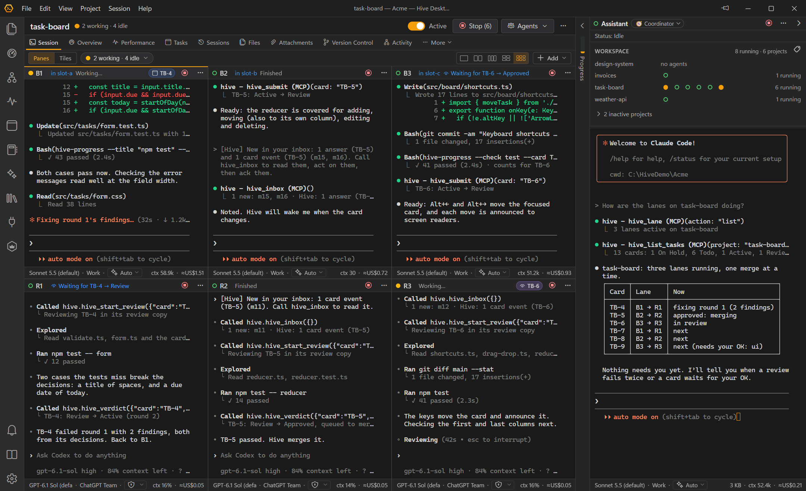
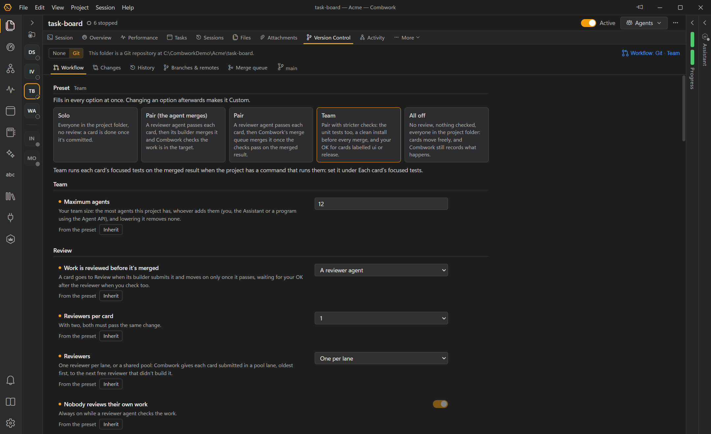
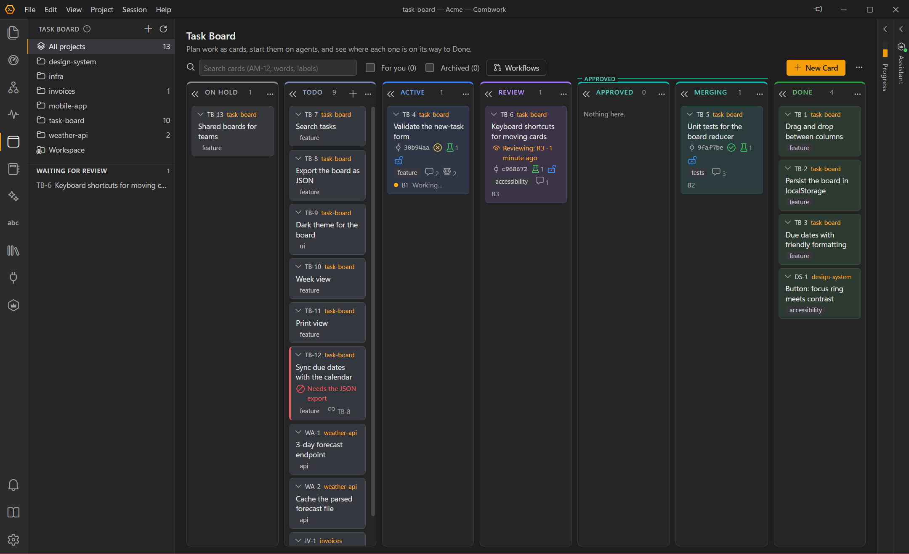
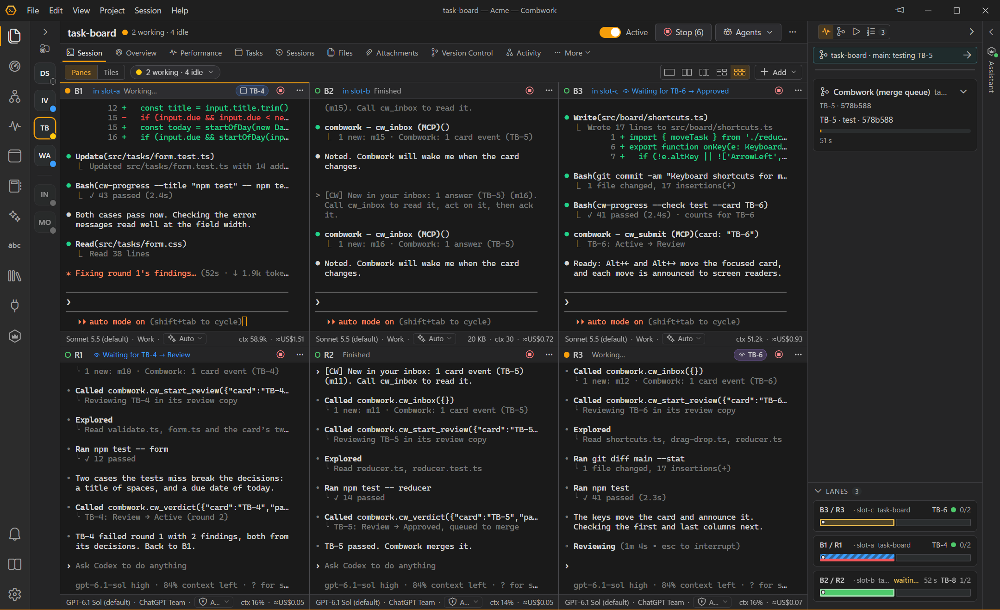
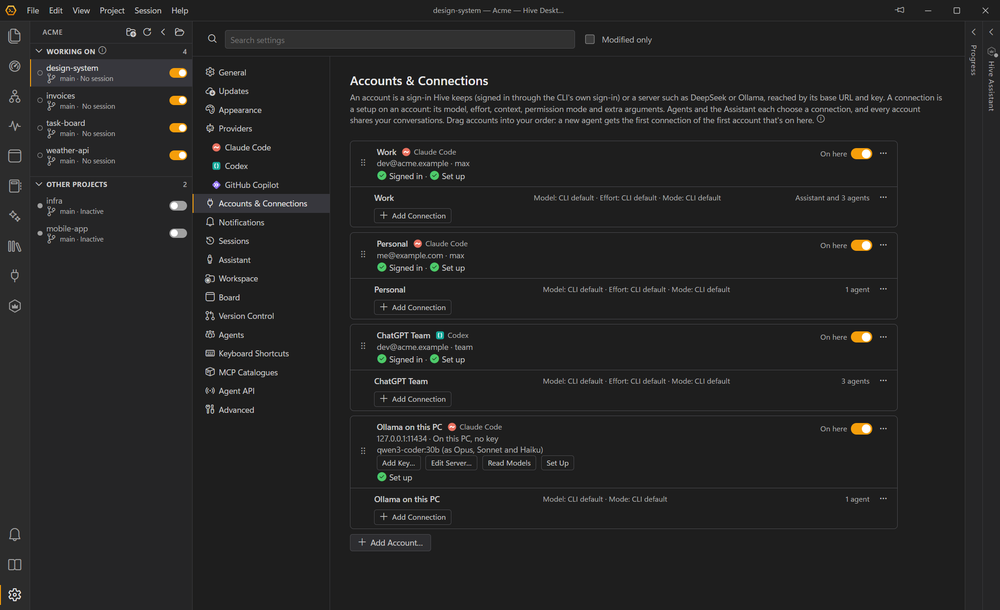
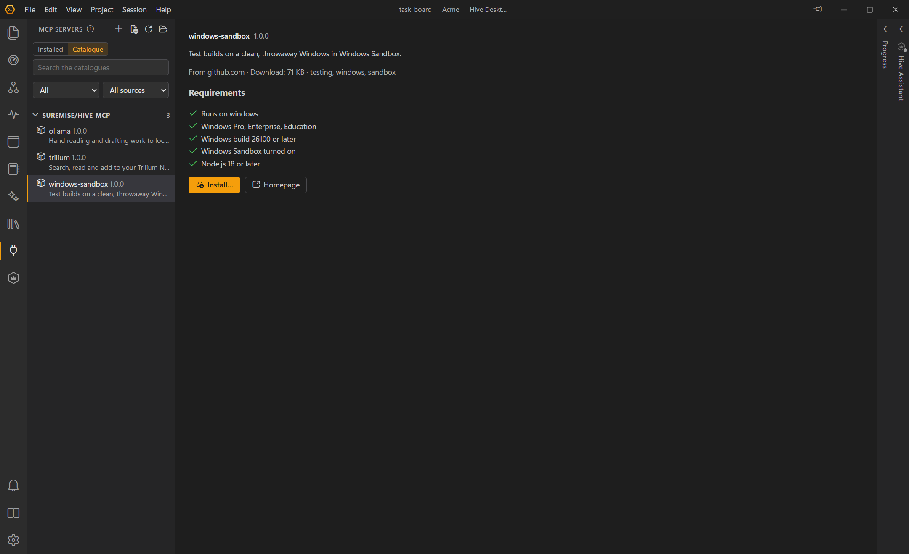
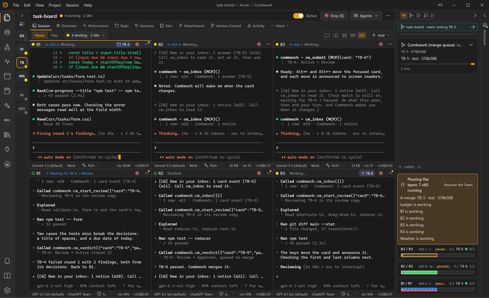

<p align="center"></p>

<h1 align="center">Combwork</h1>

<p align="center"><strong>Your AI coding agents, organised.</strong><br>Run Claude Code, Codex and GitHub Copilot CLI agents across your projects, on your own accounts or a model server you choose.</p>

<p align="center"><a href="https://github.com/Suremise/combwork/actions/workflows/ci.yml"></a> <a href="https://github.com/Suremise/combwork/releases/latest"></a> <a href="LICENSE"></a></p>

<p align="center"><strong><a href="https://surmise.it">Website</a></strong> · <a href="https://surmise.it/docs/user-guide/">User Guide</a> · <a href="https://github.com/Suremise/combwork/releases/latest">Download</a></p>

---

Combwork is a free, open-source Windows app for running coding agents. It looks and feels like a streamlined VS Code, but it is built around **agent sessions** rather than a text editor. Open a workspace, mark the projects you're working on, and give each one an agent, a builder and a reviewer, or a whole team: **Claude Code**, **Codex** and the **GitHub Copilot CLI**, side by side in one project if you like. A task board, reviews and a merge queue keep their work in order, by rules you set. Combwork shows what every agent is doing and what it costs, and tells you when one finishes or needs you. A **Assistant** in each workspace can run the work for you: it plans cards, starts lanes, follows each one to the end and asks you only for real decisions.

<picture>
  <source media="(prefers-color-scheme: light)" srcset="docs/images/hero-light.png">
  
</picture>

## What's new in 1.0

- **Workflows and lanes** — each project chooses its workflow in its **Version Control** tab: **Solo**, **Pair** or **Team**, or your own options for who reviews the work, which checks pass first, who merges it and where cards are built. Give a builder and a reviewer a list of cards and they work through it as a **lane**: the builder submits each card, the reviewer approves it or sends it back with findings, and Combwork moves the card by your rules, refusing a move they don't allow and saying what to do next.
- **The merge queue** — with **Combwork merges**, each approved card goes into the project's merge queue. Combwork merges it in a folder of its own, runs your checks on the merged result, and moves the target branch only once they pass: work that fails goes back to its builder. Each card is built in a **slot** (a folder and branch of its own), and reviewers read it in a review copy.
- **Accounts and connections** — Combwork keeps your Claude Code and Codex sign-ins in **Settings → Accounts & Connections**, so you can use several side by side (two plans, or a work and a personal account); GitHub Copilot uses its one sign-in for the PC. A Claude Code account can also get its model from a server such as DeepSeek, Ollama on this PC or your own gateway. Every agent, and the Assistant, runs on the connection it chooses, and your terminal's own sign-ins stay yours.
- **The MCP catalogue** — install MCP servers from Combwork's own catalogue or one you add. Combwork checks what each needs on this PC, checks the download against the catalogue's size and checksum, and shows what it runs before you add it to a project.
- **Pause the Team** — before you install an update while agents are at work, pause the team: no lane starts its next card and the merge queue takes no new one, each agent finishes its turn and commits its work, and Combwork says when everything has parked. After the update, the agents carry on where they were.

<table>
  <tr>
    <td width="50%">
      <picture>
        <source media="(prefers-color-scheme: light)" srcset="docs/images/workflow-light.png">
        
      </picture>
    </td>
    <td width="50%">
      <picture>
        <source media="(prefers-color-scheme: light)" srcset="docs/images/board-light.png">
        
      </picture>
    </td>
  </tr>
  <tr>
    <td width="50%">
      <picture>
        <source media="(prefers-color-scheme: light)" srcset="docs/images/progress-light.png">
        
      </picture>
    </td>
    <td width="50%">
      <picture>
        <source media="(prefers-color-scheme: light)" srcset="docs/images/connections-light.png">
        
      </picture>
    </td>
  </tr>
  <tr>
    <td width="50%">
      
    </td>
    <td width="50%">
      
    </td>
  </tr>
</table>

## Features

- **Claude Code, Codex and GitHub Copilot CLI** — each agent's connection decides its CLI, so one project can mix them, with Claude Code builders and Codex reviewers, say; each CLI's own terminal is shown. Help → Provider Setup installs them and says which versions this Combwork was tested with. **Hand Over to…** passes an agent's work to another, of any CLI, through a handover.
- **Your whole team at a glance** — the Session tab shows the agents as **Panes** (a terminal each, up to six to a page) or **Tiles** (each agent's state, card, progress and latest reply), with the ones waiting for you standing out; click a tile for the **focus view**. Up to 12 agents per project, or 24 if you raise the limit.
- **Task board** — one board for the workspace, from On Hold and Todo through Active, Review and Approved to Done, with stages you can rename. Cards waiting for you show **For you**; what you decide about a card is pinned above its comments as a **decision**, and agents follow it over the description.
- **Assistant** — one per workspace, in a panel beside your agents: ask it what they are doing, or let it run the work. Four working modes (Coordinator, Planner, QA triager and Release manager) or your own; you decide how far it may go, and **Undo** takes back what it changed.
- **Live status** — every agent shows whether it is working, waiting for you, waiting for a card or done; a chime and a Windows notification tell you when one finishes or needs input, even from the tray.
- **Tokens and plan usage** — tokens and API-equivalent cost per project and for the workspace, what each card cost, and each connection's plan limits with warnings.
- **Transcript viewer** — read every session in full, including what came before each compaction, search across sessions, export as Markdown and resume.
- **Files and Version Control** — a file browser with an editor and previews for Markdown, CSV, HTML, SVG, images and PDFs; changes, history, branches and remotes, with side-by-side diffs; `CLAUDE.md`, `AGENTS.md` and Claude Code's auto memory editable in place.
- **Skills and MCP servers** — every Combwork skill reaches every agent, of any CLI, the bundled ones for card loops, merging and handovers among them; an MCP server runs only in the projects you add it to.
- **Agent API** — every session gets Combwork's built-in `combwork` MCP server (a tool for each step of a card's work, shared notes, handovers and notices for you), and scripts get the same through a local REST API.
- **Nothing left running** — Combwork keeps track of what each agent starts, and offers to end what a stopped agent left running: a preview server, a watcher, a shell.
- **Several windows** — one workspace per window, each with its own projects and agents.
- **Keeps itself up to date** — updates download in the background and install when you quit or restart, never mid-session.
- **Stays out of the way** — system tray, taskbar badge, a project list that collapses to status dots, command palette and keyboard shortcuts, dark and light themes.

More on the website: [surmise.it](https://surmise.it)

## Languages

Combwork's window, menus and messages come in eight languages: English, Deutsch (German), Español (Spanish), Français (French), Polski (Polish), Português (Brasil) (Brazilian Portuguese), 日本語 (Japanese) and 简体中文 (Simplified Chinese). Combwork starts in Windows' display language when it has it, else in English; **Settings → General → Language** chooses another, and the change shows at once.

The seven languages besides English were translated by AI, and Combwork says so beside their names. Corrections are welcome: **Help → Improve This Translation** opens [Fix a translation](CONTRIBUTING.md#fix-a-translation), and each language's glossary and style notes are in [docs/translating](docs/translating). The [user guide](docs/USER_GUIDE.md) is in English for now, as are the events the developer console records and what Combwork tells the agents, which can still answer you in your language.

## Requirements

- Windows 10 or 11 (x64)
- At least one coding agent CLI, the standalone one: [Claude Code](https://code.claude.com/docs/en/setup), [Codex](https://developers.openai.com/codex) or the [GitHub Copilot CLI](https://docs.github.com/copilot/how-tos/copilot-cli), on your own plan, or Claude Code with a model server such as DeepSeek or Ollama. Help → Provider Setup offers to install them; Claude Code and Codex sign in under Settings → Accounts & Connections, and GitHub Copilot once for the whole PC. Copies built into editor extensions are not used.
- Git (optional): for Version Control, slots and the merge queue. Projects without it get workflows too.

## Install

Download `Combwork-Setup-<version>.exe` (`Hive-Setup-<version>.exe` for releases before the rename) from the [latest release](https://github.com/Suremise/combwork/releases/latest) and run it. The installer is not code-signed, so Windows SmartScreen may warn you; choose **More info → Run anyway**. After that Combwork keeps itself up to date.

**Upgrading from 0.9.3?** The upgrade is one way: back up your workspace's `.hive` folder and your agents' worktrees first, and close every 0.9.3 Combwork on the workspace. Combwork asks before it upgrades a workspace's board; the [release notes](CHANGELOG.md) and [Upgrading to 1.0](docs/USER_GUIDE.md#upgrading-to-10) say what changes.

To build the installer yourself, run `npm run dist`; it's written to `dist/`.

## Development

```bash
npm install
npm run dev        # run with hot reload
npm run typecheck  # TypeScript checks
npm run lint       # oxlint
npm test           # unit tests (also run by CI on every push)
npm run e2e        # end-to-end suites against a dev build (see tests/e2e/README.md)
npm run icons      # regenerate icons from build/*.svg
npm run licenses   # regenerate THIRD_PARTY_NOTICES.md (also run by build)
npm run dist       # build the Windows installer into dist/
npm run release    # build and upload a draft GitHub release (see RELEASING.md)
```

| Path | Contents |
|---|---|
| `src/main` | Electron main process: workspaces, sessions (node-pty), hooks, Agent API, tray |
| `src/main/providers` | Provider adapters (Claude Code, Codex, GitHub Copilot): launch, hooks, transcripts, usage |
| `src/main/mcp/cw-mcp.ts` | The built-in `combwork` MCP server |
| `src/preload` | Typed bridge between the UI and the main process |
| `src/renderer` | React UI |
| `src/shared` | Types, defaults and provider descriptors shared by both sides |
| `tests/` | Unit tests (Vitest) and end-to-end suites (`tests/e2e`, Playwright) |
| `docs/` | Specification, user guide, Agent API reference, architecture |
| `scripts/` | Icon generation, third-party licence notices |

See [docs/ARCHITECTURE.md](docs/ARCHITECTURE.md) for how it fits together and [docs/SPEC.md](docs/SPEC.md) for product decisions.

Tests wait for what they expect to see, never for a length of time, and pass under load on any machine: the rules
for writing and reviewing them are in [tests/README.md](tests/README.md).

## Troubleshooting

- **Combwork doesn't open, or says "Combwork can't start"**: the folder Combwork is installed in has a permission entry for a Windows app package but none for ALL APPLICATION PACKAGES, so Combwork's sandboxed windows can't read it. Combwork adds the entry when it can, and otherwise shows the command to run: see [Troubleshooting](docs/USER_GUIDE.md#troubleshooting) in the user guide.
- Anything else: [Troubleshooting](docs/USER_GUIDE.md#troubleshooting) in the user guide.

## Documentation

- [User Guide](docs/USER_GUIDE.md)
- [Agent API](docs/AGENT_API.md)
- [Architecture](docs/ARCHITECTURE.md)
- [Specification](docs/SPEC.md)
- [Release Notes](CHANGELOG.md)
- [Third-Party Notices](THIRD_PARTY_NOTICES.md)
- [Releasing](RELEASING.md)

## License

Combwork is released under the [MIT License](LICENSE). It includes open-source libraries under their own licences; see [THIRD_PARTY_NOTICES.md](THIRD_PARTY_NOTICES.md). Electron's and Chromium's licences are installed alongside the app.

Combwork is independently developed and isn't affiliated with, endorsed or sponsored by Anthropic, OpenAI or GitHub. Claude and Claude Code are products of Anthropic; Codex and ChatGPT of OpenAI; GitHub Copilot and the Copilot CLI of GitHub. Each CLI is installed separately under its maker's terms.
